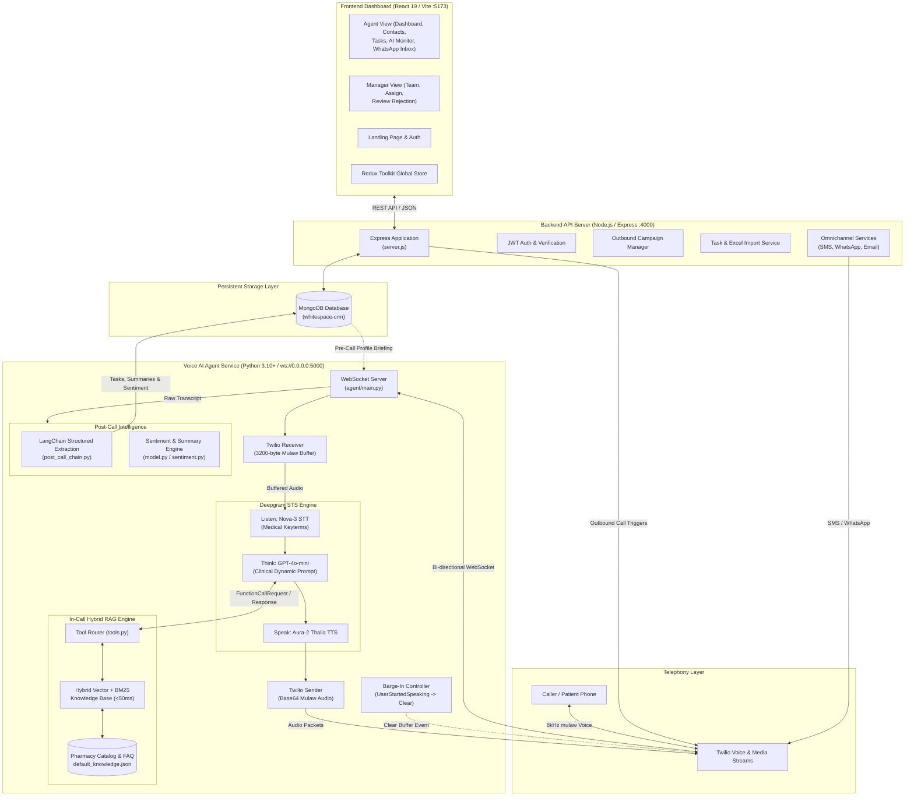
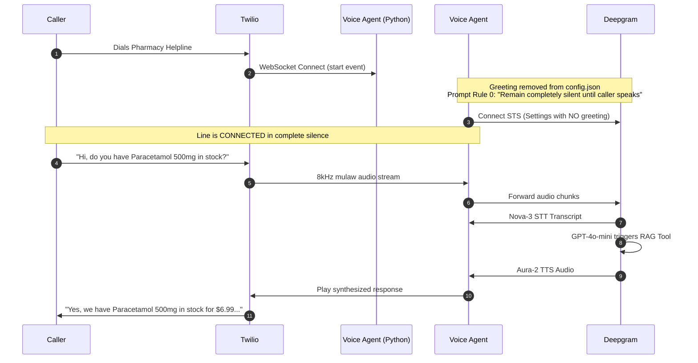
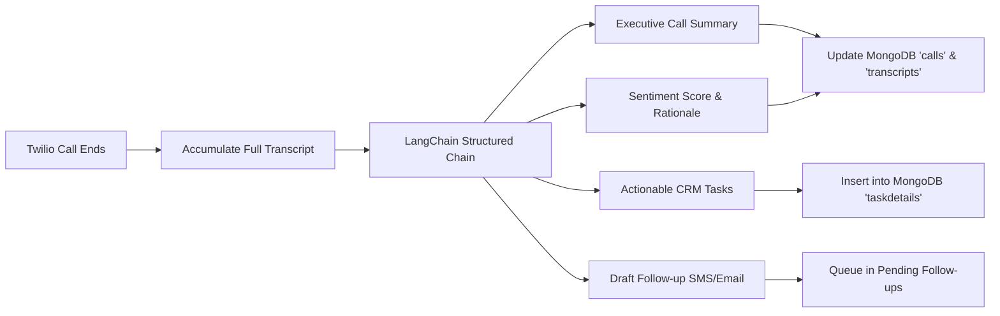

# Samarthya CRM
### Omnichannel CRM with Real-Time Voice AI, LangChain & Hybrid RAG for Organizations and Institutions

[](https://react.dev/)
[](https://vitejs.dev/)
[](https://tailwindcss.com/)
[](https://redux-toolkit.js.org/)
[](https://nodejs.org/)
[](https://expressjs.com/)
[](https://www.mongodb.com/)
[](https://www.python.org/)
[](https://www.twilio.com/)
[](https://deepgram.com/)
[](https://www.langchain.com/)

---

## 📑 Table of Contents

1. [Executive Summary](#-executive-summary)
2. [Key Differentiators & Highlights](#-key-differentiators--highlights)
3. [System Architecture](#-system-architecture)
4. [Repository Directory Structure](#-repository-directory-structure)
5. [Subsystem Deep Dives](#-subsystem-deep-dives)
   - [5.1 Voice AI Agent (`agent/`)](#51-voice-ai-agent-agent)
   - [5.2 Backend API Server (`server/`)](#52-backend-api-server-server)
   - [5.3 Frontend CRM Client (`client/`)](#53-frontend-crm-client-client)
   - [5.4 Documentation Suite (`docs/`)](#54-documentation-suite-docs)
6. [Core Technical Workflows](#-core-technical-workflows)
   - [Silent Call Reception Protocol](#silent-call-reception-protocol)
   - [In-Call Real-Time Hybrid RAG (<50ms)](#in-call-real-time-hybrid-rag-50ms)
   - [Pre-Call Context Retrieval & Dynamic Grounding](#pre-call-context-retrieval--dynamic-grounding)
   - [Post-Call LangChain Intelligence Pipeline](#post-call-langchain-intelligence-pipeline)
   - [Barge-In & Live Interruption Handling](#barge-in--live-interruption-handling)
7. [API & Telephony Reference](#-api--telephony-reference)
8. [Installation & Setup Guide](#-installation--setup-guide)
9. [Environment Variables Reference](#-environment-variables-reference)
10. [Database Schema Overview](#-database-schema-overview)
11. [Testing & Quality Verification](#-testing--quality-verification)
12. [Development Roadmap & Backlog](#-development-roadmap--backlog)

---

## 🌟 Executive Summary

**Samarthya CRM** (also referred to as **Whitespace CRM**) is an enterprise-grade, omnichannel customer relationship management platform purpose-built for healthcare providers, pharmacies, clinics, and medical contact centers.

While traditional CRMs record static records after manual agent entry, Samarthya CRM deploys an autonomous, full-duplex **Voice AI Agent** that handles live telephone interactions with zero human intervention. The platform bridges **Twilio Media Streams** with **Deepgram's Speech-to-Speech (STS)** pipeline, executes sub-50ms local **Retrieval-Augmented Generation (RAG)** over clinical pharmaceutical knowledge bases, automatically registers orders, scores caller sentiment, generates structured follow-up tasks, and orchestrates multi-channel customer communications across **SMS**, **WhatsApp**, and **Email**.

---

## 🚀 Key Differentiators & Highlights

| Feature | Description | Technical Implementation |
|---|---|---|
| **Sub-Second Voice Latency** | Natural human turn-taking with end-to-end voice turnaround < 1000ms. | Full-duplex WebSocket streaming (Twilio 8kHz mulaw $\leftrightarrow$ Deepgram STS). |
| **Silent Call Reception** | Agent answers inbound calls silently without robotic auto-greetings; listens first. | Stripped greeting payload + prompt Rule 0 injection in `agent/main.py`. |
| **Sub-50ms Hybrid RAG** | Immediate clinical facts, medication dosages, drug interactions, and pricing. | In-memory hybrid vector cosine similarity combined with BM25 keyword matching. |
| **Instant Barge-In** | Caller can interrupt the AI at any millisecond; AI stops speaking immediately. | Deepgram `UserStartedSpeaking` event sends Twilio `{"event": "clear"}` buffer purge. |
| **Pre-Call Context Grounding** | Voice agent is briefed on caller history, past transcripts, and prescriptions before audio starts. | Dynamic MongoDB aggregation in `agent/functions/rag/customer_context.py`. |
| **Post-Call Intelligence** | Transcripts automatically yield summaries, sentiment scores, and tasks. | LangChain structured chains (`PydanticOutputParser` / OpenAI / Gemini / HF). |
| **Omnichannel Dispatch** | Unified inbox and direct customer outreach over SMS, WhatsApp, and Email. | Twilio Programmable SMS & WhatsApp + Nodemailer SMTP integration. |
| **Clinical SaaS Dashboard** | Modern, responsive interface tailored for agents and managers. | React 19, Vite, Tailwind CSS v4, Redux Toolkit, Radix UI primitives. |

---

## 🏛️ System Architecture



---

## 📁 Repository Directory Structure

```text
samarthya-crm/
│
├── .gitignore                          # Root Git ignore rules (node_modules, .env, __pycache__, logs)
├── package-lock.json                   # Root package lockfile
├── README.md                           # Main repository documentation & engineering reference
│
├── agent/                              # 🎙️ Python Real-Time Voice AI Service
│   ├── main.py                         # Primary WebSocket server & Twilio/Deepgram pipeline router
│   ├── config.json                     # Deepgram Voice Agent settings, STT/TTS params & tool schemas
│   ├── pyproject.toml                  # Python package configuration
│   ├── requirements.txt                # Python dependencies (websockets, pymongo, langchain, pydantic)
│   ├── uv.lock                         # UV lockfile for deterministic dependency management
│   ├── .python-version                 # Target Python interpreter version (3.13 / 3.10+)
│   ├── .env.example                    # Example environment file for agent service
│   ├── test_rag_integration.py         # Automated integration test suite for RAG & tool calling
│   │
│   ├── functions/                      # Core agent computational modules
│   │   ├── rag/                        # Retrieval-Augmented Generation & Tool Calling
│   │   │   ├── customer_context.py     # Pre-call DB query: aggregates caller history & prescription context
│   │   │   ├── knowledge_base.py       # High-speed hybrid vector (cosine) + BM25 keyword search engine
│   │   │   ├── tools.py                # Deepgram function calling schemas (search_knowledge_base, place_order)
│   │   │   ├── post_call_chain.py      # LangChain structured output chain: summary, sentiment, auto-tasks
│   │   │   └── data/
│   │   │       └── default_knowledge.json # Pharmacy inventory, prices, dosages, hours & FAQs
│   │   │
│   │   ├── transcript/                 # Turn-by-turn conversation & persistence
│   │   │   ├── model.py                # MongoDB transcript ingestion, status sync & post-call trigger
│   │   │   ├── sentiment.py            # Hugging Face & local fallback sentiment/summary utilities
│   │   │   └── transcript_code.py      # Session-based in-memory transcript accumulator & file writer
│   │   │
│   │   └── testing/                    # Test utilities & legacy catalog operations
│   │       └── pharmacy_functions.py   # Medication lookups, order verification mocks
│   │
│   └── local_db/                       # Local file-based storage cache
│       ├── db.json                     # Local mock database for offline fallback
│       ├── live_call.json              # Active in-flight call state
│       ├── transcript.json             # Live-streamed transcript turns for active call
│       └── calls/                      # Completed call archive (CA<callSid>.json)
│
├── server/                             # 🌐 Node.js / Express REST API & Orchestration Backend
│   ├── server.js                       # Express server entry point, middleware, routes & WhatsApp handler
│   ├── package.json                    # Node dependencies & run scripts
│   ├── package-lock.json               # Node lockfile
│   ├── .gitignore                      # Server-specific ignore rules
│   ├── send_email.js                   # Standalone test script for email dispatch
│   ├── send_sms.js                     # Standalone test script for SMS dispatch
│   ├── test.js                         # Server sanity and endpoint test script
│   │
│   ├── config/                         # Backend configuration
│   │   └── auth/                       # Nodemailer transporter setup & email auth
│   │       ├── nodemailer.js           # SMTP client pool configuration
│   │       └── testmail.js             # Email connectivity verification
│   │
│   ├── controller/                     # Business logic controllers
│   │   ├── agent/                      # Contact and campaign controllers
│   │   │   ├── addList.js              # Create & manage contact lists
│   │   │   ├── allContacts.js          # Fetch, filter, and paginate contact records
│   │   │   ├── calliniciate.js         # Trigger outbound AI calls via Twilio REST API
│   │   │   ├── callStatus.js           # Twilio call status webhook callback handler
│   │   │   ├── campaignController.js   # Automated outbound calling campaign orchestration
│   │   │   └── folderController.js     # Contact folder categorization
│   │   ├── aiCallManager/              # AI call management & lead tracking
│   │   │   ├── allLeads.js             # Leads aggregation, scoring & stage progression
│   │   │   ├── callHistory.js          # Historical call logs, transcripts & audio recordings
│   │   │   ├── pendingFollowups.js     # Unresolved post-call action items
│   │   │   └── index.js                # Combined AI Call Manager route handlers
│   │   ├── auth/                       # User authentication & RBAC
│   │   │   ├── authController.js       # Register, login, logout, checkAuth (JWT via HTTP-only cookie)
│   │   │   └── userVerified.js         # Email OTP verification & user activation
│   │   ├── calls/                      # Call telemetry & historical statistics
│   │   │   └── callhistory.js          # Call durations, status metrics, and aggregations
│   │   ├── createTask/                 # Task creation & bulk file ingestion
│   │   │   ├── index.js                # CRUD for CRM tasks
│   │   │   ├── processxlccv.js         # Parser for uploaded customer contact spreadsheets
│   │   │   └── upload.js               # Multer upload handler for CSV/XLSX
│   │   └── dashboard/                  # Dashboard analytical metrics
│   │       ├── barchat.js              # Daily/weekly call volume and sentiment distributions
│   │       ├── weaklychat.js           # Weekly interaction analytics
│   │       └── index.js                # High-level KPI aggregations
│   │
│   ├── helper/                         # Utility helpers
│   │   ├── processxl.js                # Excel/CSV parser and column normalizer
│   │   └── uploadxls.js                # Multer storage configuration for uploads
│   │
│   ├── models/                         # Mongoose MongoDB Data Schemas
│   │   ├── userModel.js                # System users, roles (Agent/Manager), hashed passwords
│   │   ├── contactDetails.js           # Contact records with tags, phone numbers, and notes
│   │   ├── uploadDetails.js            # Bulk-uploaded customer details & clinical inquiries
│   │   ├── callHistory.js              # Twilio Call SIDs, durations, status, sentiment & transcript links
│   │   ├── callLiveStatus.js           # Real-time state of in-flight telephony sessions
│   │   ├── createTask.js               # CRM tasks generated automatically or assigned manually
│   │   ├── campaign.js                 # Campaign definitions, schedules, target lists & metrics
│   │   ├── Message.js                  # SMS message transaction logs
│   │   ├── WhatsAppMessage.js          # Two-way WhatsApp conversation log
│   │   └── Counter.js                  # Auto-incrementing sequence counter
│   │
│   ├── router/                         # Express API route declarations
│   │   ├── agent/contactList.js        # Contact list CRUD & filtering routes
│   │   ├── aiCall-Manager/index.js     # AI Call monitoring, history & lead routes
│   │   ├── auth/authRoute.js           # /api/auth (login, register, logout, checkAuth)
│   │   ├── auth/userRoute.js           # /api/user (OTP verification, profile updates)
│   │   ├── campaign/campaigns.js       # /api/campaigns (start, pause, metrics)
│   │   ├── createTask/index.js         # /api/agent/create-task (tasks & bulk Excel upload)
│   │   ├── Dashboard/index.js          # /api/dashboard (KPIs, charts, analytics)
│   │   └── msg/                        # Multi-channel messaging routers
│   │       ├── emailRoutes.js          # /api/email (single & bulk email dispatch)
│   │       ├── messageRoutes.js        # /api/messages (message history)
│   │       ├── smsRoutes.js            # /api/sms (Twilio SMS outbound dispatch)
│   │       └── whatsappRoutes.js       # /api/whatsapp (Twilio WhatsApp chat routes)
│   │
│   ├── services/                       # Outbound external API integrations
│   │   ├── autoCallerService.js        # Twilio REST API wrapper for automated outbound calling
│   │   ├── emailService.js             # Nodemailer HTML template engine & email dispatcher
│   │   └── smsService.js               # Twilio SMS API helper with delivery tracking
│   │
│   └── uploads/                        # Server temporary file storage for uploaded spreadsheets
│
├── client/                             # 💻 Modern React 19 + Vite Frontend Application
│   ├── index.html                      # Single page application entry HTML
│   ├── package.json                    # Frontend dependencies (React 19, Tailwind v4, Lucide, Redux)
│   ├── vite.config.js                  # Vite configuration & dev server proxies
│   ├── tailwind.config.js              # Tailwind CSS configuration
│   ├── postcss.config.js               # PostCSS styling pipeline
│   ├── components.json                 # Shadcn / Radix component configuration
│   ├── jsconfig.json                   # Path alias mappings (`@/*`)
│   │
│   ├── public/                         # Static assets & sample datasets
│   │   ├── customer_issues_sample.csv  # Sample customer data for task bulk import testing
│   │   ├── customer_issues_sample.xlsx # Sample spreadsheet format
│   │   └── vite.svg                    # Application logo
│   │
│   └── src/                            # Application source code
│       ├── main.jsx                    # React root render with Redux Provider & BrowserRouter
│       ├── App.jsx                     # Route architecture, auth protection & layout wrapping
│       ├── index.css                   # Global Tailwind styling, theme tokens & scrollbars
│       ├── App.css                     # Custom component animations
│       │
│       ├── assets/                     # UI graphics, brand icons, and illustration vectors
│       ├── config/                     # Form schemas & field definitions (auth, contacts, tasks)
│       ├── lib/                        # Utility functions (`cn` for Tailwind class merging)
│       │
│       ├── components/                 # Reusable UI component library
│       │   ├── agent-view/             # Agent sidebar (`SidebarDemo.jsx`), call widgets, tables
│       │   ├── manager-view/           # Manager navigation (`SidebarManager.jsx`), team panels
│       │   ├── front-view/             # Public marketing site headers & footers
│       │   ├── authentication/         # Auth wrapper layout (`AuthLayout.jsx`)
│       │   └── ui/                     # Radix UI primitives (Dialog, Tabs, Avatar, Badge, etc.)
│       │
│       ├── pages/                      # Application route views
│       │   ├── landing/                # Public SaaS landing page (`Landing.jsx`, Hero, FAQ, Pricing)
│       │   ├── auth/                   # Authentication screens (`LoginPage`, `RegisterPage`, `EmailVer`)
│       │   ├── agent-view/             # Clinical & Agent workspace screens:
│       │   │   ├── dashboard/          # Performance metrics, call counts, sentiment graphs
│       │   │   ├── task-management/    # CRM task board, status toggles, Excel/CSV upload modal
│       │   │   ├── contacts/           # Contact directory, search, filter, direct call trigger
│       │   │   ├── leads/              # Lead management pipeline, stage tagging, qualification
│       │   │   ├── aicallmanager/      # Real-time call monitor, audio stream indicators, call history
│       │   │   ├── pending-followups/  # Post-call callback queue & unresolved clinical alerts
│       │   │   ├── campaigns/          # Outbound campaign builder, batch dialing, progress bars
│       │   │   ├── whatsapp-inbox/     # Interactive two-way WhatsApp chat console
│       │   │   └── compose-message/    # Multi-channel composer (SMS, WhatsApp, Email)
│       │   └── manager-view/           # Supervisory controls:
│       │       ├── Man.jsx             # Manager executive overview
│       │       ├── Team.jsx            # Staff roster, role allocation, agent performance
│       │       ├── Assign.jsx          # Lead & task assignment distribution engine
│       │       └── ReviewRejection.jsx # Quality assurance audit for escalated/rejected tasks
│       │
│       └── store/                      # Redux Toolkit State Management
│           ├── index.js                # Central Redux store configuration
│           ├── auth-slice/             # Authentication status, user profile & token lifecycle
│           ├── agent-slice/            # Contact lists, folders, and contact details
│           ├── allLeads/               # Lead collection and pipeline stage updates
│           ├── call-mannager/          # Call history, live monitors, and pending followups
│           ├── call-slice/             # Call initiation state and active stream metadata
│           ├── campaign/               # Outbound campaign creation and metrics
│           ├── create-task/            # Task creation, file upload progress, and assignments
│           └── dashboard/              # Aggregate statistics, charts, and activity streams
│
└── docs/                               # 📚 Complete System Engineering Documentation
    ├── PRD.md                          # Product Requirements Document (Goals, Personas, KPIs)
    ├── architecture.md                 # Detailed System Architecture & Low-Latency Audio Specs
    ├── design.md                       # Design System, Color Tokens, Accessibility & Voice UX
    ├── interview-guide.md              # Technical Deep Dive, Architectural Q&A & Interview Prep
    ├── project-memory.md               # Repository Identity, ADR Summaries & Database Schemas
    └── task.md                         # Project Development Roadmap, Milestones & Backlog
```

---

## 🔍 Subsystem Deep Dives

### 5.1 Voice AI Agent (`agent/`)

The voice agent is built in Python (3.10+) using `asyncio` and `websockets`. It acts as an ultra-low latency bridge between Twilio Media Streams and Deepgram's Speech-to-Speech API.

- **`main.py`**:
  - Sets up a persistent WebSocket server on port `5000`.
  - Ingests inbound audio chunks from Twilio, decodes base64 `audio/x-mulaw`, buffers into 3,200-byte frames (20 chunks of 160 bytes), and pipes them directly to Deepgram.
  - Receives synthesized binary audio from Deepgram, encodes to base64 `audio/x-mulaw`, and delivers it back to Twilio with the appropriate `streamSid`.
  - Manages concurrent `asyncio` tasks for receiving and sending audio, ensuring zero blocking.
  - Triggers the post-call intelligence pipeline immediately upon receiving Twilio's `stop` event.
- **`config.json`**:
  - Configures the Deepgram conversational agent:
    - **STT (Listen)**: Model `nova-3` with specialized pharmacy terminology keyterms.
    - **LLM (Think)**: OpenAI `gpt-4o-mini` with dynamic temperature and clinical system prompts.
    - **TTS (Speak)**: Deepgram `aura-2-thalia-en` (human-like conversational voice).
- **`functions/rag/`**:
  - `knowledge_base.py`: Hybrid vector (in-memory cosine similarity) and BM25-style keyword search over medication catalogs, dosages, brand names (Dolo, Crocin, Tylenol, Advil, etc.), pricing, return policies, and pharmacy hours. Resolves in `<50ms`.
  - `tools.py`: Declarative tool definitions exposed to Deepgram's function calling interface (`search_knowledge_base`, `place_order`, `lookup_order`).
  - `customer_context.py`: Pre-call grounding engine. Queries MongoDB (`uploaddetails`, `contactdetails`, `calls`) using the incoming caller's identifier and builds a customized pre-call brief injected into the system prompt.
  - `post_call_chain.py`: Post-call extraction chain powered by LangChain and structured Pydantic schemas. Produces executive summaries, sentiment ratings (Positive/Neutral/Negative) with justifications, actionable follow-up tasks, and pre-drafted customer follow-up messages.
- **`functions/transcript/`**:
  - `transcript_code.py`: Thread-safe, turn-by-turn conversational accumulator. Keeps live state synchronized with `local_db/transcript.json`.
  - `model.py`: Ingests completed transcripts into MongoDB's `transcripts` collection, calculates duration, executes post-call processing, and commits tasks to `taskdetails`.

---

### 5.2 Backend API Server (`server/`)

The backend is built with Node.js and Express 5, utilizing Mongoose for MongoDB ODM and Twilio SDK for telephony and messaging orchestration.

- **`server.js`**:
  - Main HTTP server listening on port `4000`.
  - Configures CORS for the Vite dev server (`http://localhost:5173`) with credentials support.
  - Configures cookie parsing and JSON body parsers.
  - Mounts feature routers for authentication, agent contacts, AI call operations, campaigns, dashboard metrics, and messaging channels.
  - Houses the unified `/api/send-whatsapp` route supporting both WhatsApp sandbox (`whatsapp:+14155238886`) and standard SMS.
- **`services/`**:
  - `autoCallerService.js`: Dispatches outbound calls via Twilio REST API, establishing a TwiML Media Stream pointing to the Python Voice Agent WebSocket URL.
  - `smsService.js`: Sends transactional and promotional SMS notifications.
  - `emailService.js`: Sends rich HTML emails via Nodemailer SMTP.
- **`controller/createTask/processxlccv.js`**:
  - Handles multipart spreadsheet uploads (XLSX, CSV) containing lead lists or patient inquiry queues.
  - Normalizes columns (Name, Phone, Symptoms/Description), deduplicates records, and batch-inserts them into MongoDB `uploaddetails` for automated campaign targeting.

---

### 5.3 Frontend CRM Client (`client/`)

A high-performance Single Page Application (SPA) built on React 19 and Vite with Tailwind CSS v4.

- **Routing & Navigation (`App.jsx`)**:
  - Public Routes: Landing page (`/`), Authentication (`/auth/login`, `/auth/register`, `/auth/send-verify-otp`).
  - Agent Workspace (`/agent`):
    - `/agent/dashboard`: Real-time KPI cards, weekly call volume charts, sentiment breakdowns.
    - `/agent/aicallmanager`: Live active call monitor, audio stream indicators, call history table with audio playback and transcripts.
    - `/agent/task-management`: Automated post-call task board, status toggles, Excel/CSV lead upload modal.
    - `/agent/my-contacts`: Patient directory with search, filter, and one-click outbound AI call trigger.
    - `/agent/leads`: Lead pipeline stages, qualification statuses, notes.
    - `/agent/pending-followups`: Dedicated queue for high-priority pharmacist callback alerts.
    - `/agent/campaigns`: Batch outbound dialing campaign creator and progress tracker.
    - `/agent/whatsapp-inbox`: Full two-way WhatsApp conversational chat interface.
    - `/agent/composemessage`: Omnichannel multi-dispatch modal (SMS, WhatsApp, Email).
  - Manager Workspace (`/manager`):
    - `/manager/dashboard`: Executive overview of team throughput and call volumes.
    - `/manager/team`: Staff directory and workload distribution.
    - `/manager/assign`: Automated or manual task assignment to available agents.
    - `/manager/review-rejection`: QA queue for reviewing customer complaints or rejected calls.
- **Centralized State (`store/`)**:
  - Redux Toolkit slices handle asynchronous data fetching, caching, and state transitions across all entities without prop drilling.

---

### 5.4 Documentation Suite (`docs/`)

The repository includes a comprehensive, publication-ready documentation suite:

| Document | Primary Focus |
|---|---|
| [`PRD.md`](docs/PRD.md) | Product Requirements Document: Problem statement, user personas, clinical requirements, KPIs, and silent connect specifications. |
| [`architecture.md`](docs/architecture.md) | Deep technical architecture: WebSockets, audio frame buffering, Deepgram STS specs, and LangChain pipelines. |
| [`design.md`](docs/design.md) | Unified Visual Design System: Hex color tokens, semantic status badges, component standards, and Voice UX. |
| [`interview-guide.md`](docs/interview-guide.md) | Technical interview guide covering latency engineering, audio frame sizing, concurrency, and RAG design. |
| [`project-memory.md`](docs/project-memory.md) | Engineering state, Architectural Decision Records (ADRs), MongoDB collection schemas, and port bindings. |
| [`task.md`](docs/task.md) | Active development task tracker, completed feature list, and prioritized architectural backlog. |

---

## ⚡ Core Technical Workflows

### Silent Call Reception Protocol

A common defect in voice AI systems is blurting out an automated greeting (e.g., *"Hello! How can I help you today?"*) the millisecond an inbound call connects. This frequently interrupts the human caller who is already introducing themselves.



### In-Call Real-Time Hybrid RAG (<50ms)

When callers request clinical guidance, dosage recommendations, brand alternatives, prices, or store policies:

1. **Deepgram Function Calling**: Deepgram's LLM detects the intent and issues a `FunctionCallRequest` event:
   ```json
   {
     "type": "FunctionCallRequest",
     "name": "search_knowledge_base",
     "arguments": { "query": "Paracetamol dosage and price" }
   }
   ```
2. **Hybrid Execution (`knowledge_base.py`)**:
   - The query is tokenized and evaluated simultaneously against the local catalog using cosine vector similarity and keyword occurrence.
   - Exact brand matches (e.g., Crocin, Dolo, Advil, Tylenol) are boosted.
   - Result is formatted into a concise medical fact snippet in `< 50ms`.
3. **Response Feeding**: The Python agent returns a `FunctionCallResponse` back through the WebSocket.
4. **Natural Speech**: Deepgram's Aura-2 voice speaks the answer naturally as part of the continuous dialogue.

### Pre-Call Context Retrieval & Dynamic Grounding

Before establishing the Deepgram conversation:
1. `main.py` extracts the caller's phone number or `customerId` from Twilio's `customParameters`.
2. `customer_context.py` queries MongoDB:
   - Fetches patient profile from `uploaddetails` or `contactdetails`.
   - Fetches the last 3 call summaries and recorded medical conditions from `calls`.
3. Compiles a clinical context briefing injected directly into the LLM system prompt:
   ```text
   CUSTOMER BRIEFING:
   - Name: John Doe
   - Reported Condition: Chronic Migraine & Seasonal Allergies
   - Last Interaction: Inquired about Cetirizine delivery 2 days ago
   ```
4. When the caller speaks, the assistant already knows their history without asking repetitive identity verification questions.

### Post-Call LangChain Intelligence Pipeline

When the call terminates (`event: stop`):



### Barge-In & Live Interruption Handling

1. The AI voice agent streams audio chunks to Twilio.
2. While audio is playing, the caller begins speaking: *"Wait, can I also get..."*
3. Deepgram's voice activity detector fires a `UserStartedSpeaking` text event.
4. `agent/main.py` immediately transmits an interruption signal to Twilio:
   ```json
   {
     "event": "clear",
     "streamSid": "MZ1234567890abcdef"
   }
   ```
5. Twilio instantly purges its internal speaker buffer, stopping AI voice output in under 50ms with zero audio clipping or overlapping speech.

---

## 📡 API & Telephony Reference

### Express Backend Endpoints (`http://localhost:4000`)

| Method | Endpoint | Description | Authentication |
|---|---|---|---|
| `GET` | `/` | API status health check | Public |
| `GET` | `/api/health` | Comprehensive multi-channel & DB health | Public |
| **Auth** | | | |
| `POST` | `/api/auth/register` | Register new user account | Public |
| `POST` | `/api/auth/login` | Authenticate user & issue HTTP-only JWT cookie | Public |
| `POST` | `/api/auth/logout` | Clear auth cookie | Public |
| `GET` | `/api/auth/check-auth` | Validate active user session | Bearer / Cookie |
| `POST` | `/api/user/verify-otp` | Verify email OTP code for activation | Public |
| **Contacts & Lists** | | | |
| `GET` | `/api/agent/contactList/get` | Fetch all saved contacts with filters | Protected |
| `POST` | `/api/agent/contactList/add` | Add single customer contact | Protected |
| `POST` | `/api/agent/contactList/call` | Trigger outbound AI phone call to contact | Protected |
| **Tasks & Data Ingestion** | | | |
| `GET` | `/api/agent/create-task/get` | Fetch all CRM tasks | Protected |
| `POST` | `/api/agent/create-task/create` | Create new follow-up task | Protected |
| `POST` | `/api/agent/create-task/upload` | Upload & parse customer Excel/CSV spreadsheet | Protected |
| **AI Call Manager** | | | |
| `GET` | `/api/aiCall/leads` | Get all leads with stage & priority | Protected |
| `GET` | `/api/aiCall/call-history` | Get historical call logs with audio links | Protected |
| `GET` | `/api/aiCall/pending-followups`| Get pending pharmacist follow-up tasks | Protected |
| **Campaigns** | | | |
| `GET` | `/api/campaigns` | List all outbound calling campaigns | Protected |
| `POST` | `/api/campaigns/create` | Schedule a batch calling campaign | Protected |
| **Omnichannel Messaging** | | | |
| `POST` | `/api/sms/send` | Send transactional SMS via Twilio | Protected |
| `POST` | `/api/send-whatsapp` | Unified route: Send SMS or WhatsApp message | Protected |
| `POST` | `/api/email/send` | Send email notification via Nodemailer | Protected |
| `GET` | `/api/messages` | Retrieve conversation message history | Protected |
| **Dashboard** | | | |
| `GET` | `/api/dashboard/stats` | High-level metrics: total calls, orders, sentiment | Protected |
| `GET` | `/api/dashboard/charts` | Weekly call counts & sentiment time-series | Protected |

### Voice AI Agent WebSocket Protocol (`ws://0.0.0.0:5000`)

| Event Type | Direction | Description |
|---|---|---|
| `start` | Twilio $\rightarrow$ Agent | Initiates call session; supplies `streamSid`, `callSid`, and `customParameters`. |
| `media` | Twilio $\rightarrow$ Agent | Inbound audio stream containing 8kHz `audio/x-mulaw` base64 payload. |
| `media` | Agent $\rightarrow$ Twilio | Outbound synthesized AI speech containing base64 mulaw payload. |
| `clear` | Agent $\rightarrow$ Twilio | Purges Twilio playback buffer upon caller barge-in. |
| `stop` | Twilio $\rightarrow$ Agent | Signals call termination; triggers post-call LangChain intelligence. |

---

## 🛠️ Installation & Setup Guide

### Prerequisites
- **Node.js**: Version `18.x` or higher
- **Python**: Version `3.10` or higher (tested with Python 3.13)
- **MongoDB**: Local MongoDB instance or MongoDB Atlas connection URI
- **Twilio Account**: Account SID, Auth Token, and a phone number enabled for Voice & Media Streams
- **Deepgram Account**: API key with Voice Agent API access enabled


### Step 2: Configure & Start Voice AI Agent (`agent/`)

1. Open a new terminal and navigate to the agent directory:
   ```bash
   cd agent
   ```
2. Create and activate a Python virtual environment:
   ```bash
   # Windows (PowerShell)
   python -m venv .venv
   .\.venv\Scripts\Activate.ps1

   # Linux / macOS
   python3 -m venv .venv
   source .venv/bin/activate
   ```
3. Install required Python packages:
   ```bash
   pip install -r requirements.txt
   ```
4. Create your `.env` configuration:
   ```bash
   cp .env.example .env
   ```
   Configure the following mandatory keys in `agent/.env`:
   ```env
   DEEPGRAM_API_KEY=your_deepgram_api_key_here
   MONGODB_URI=mongodb+srv://<user>:<password>@cluster.mongodb.net/
   MONGODB_DB=whitespace-crm
   AGENT_HOST=0.0.0.0
   AGENT_PORT=5000
   ```
5. Run the integration test suite to verify RAG search and tool calling:
   ```bash
   python test_rag_integration.py
   ```
6. Start the voice agent WebSocket server:
   ```bash
   python main.py
   ```
   *Expected output:*
   ```text
   ==================================================
   [*] Deepgram Key: OK
   [*] MongoDB:      OK (Database: whitespace-crm)
   ==================================================
   [ONLINE] WebSocket server is RUNNING at ws://0.0.0.0:5000
   [WAITING] Ready & waiting for phone calls from Twilio...
   ==================================================
   ```

---

### Step 3: Configure & Start Backend API Server (`server/`)

1. Open a second terminal and navigate to the server directory:
   ```bash
   cd server
   ```
2. Install Node.js dependencies:
   ```bash
   npm install
   ```
3. Create your `server/.env` configuration:
   ```env
   PORT=4000
   MONGODB_URL=mongodb+srv://<user>:<password>@cluster.mongodb.net/whitespace-crm
   CORS_ORIGIN=http://localhost:5173
   JWT_SECRET=your_jwt_super_secret_key_change_in_production

   # Twilio Credentials
   TWILIO_ACCOUNT_SID=ACxxxxxxxxxxxxxxxxxxxxxxxxxxxxx
   TWILIO_AUTH_TOKEN=your_twilio_auth_token
   TWILIO_PHONE_NUMBER=+1234567890
   TWILIO_ACCOUNT_SID_WP=ACxxxxxxxxxxxxxxxxxxxxxxxxxxxxx
   TWILIO_AUTH_TOKEN_WP=your_twilio_auth_token
   TWILIO_WHATSAPP_FROM=whatsapp:+14155238886

   # Media Stream WebSocket Target (e.g. your ngrok tunnel for agent)
   MEDIA_WS_URL_BIKASH=wss://your-agent-tunnel.ngrok-free.app

   # Email Credentials (SMTP / Nodemailer)
   SMTP_HOST=smtp.gmail.com
   SMTP_PORT=587
   SMTP_USER=your-email@gmail.com
   SMTP_PASS=your-app-password
   ```
4. Start the backend server in development mode:
   ```bash
   npm run server
   ```
   *Expected output:*
   ```text
   MongoDB connected
   Server started on port: 4000
   ```

---

### Step 4: Configure & Start Frontend Dashboard (`client/`)

1. Open a third terminal and navigate to the client directory:
   ```bash
   cd client
   ```
2. Install frontend dependencies:
   ```bash
   npm install
   ```
3. Create your `client/.env` configuration (optional for Google Gemini AI integrations):
   ```env
   VITE_GEMINI_API_KEY=your_gemini_api_key_here
   ```
4. Start the Vite development server:
   ```bash
   npm run dev
   ```
   *Expected output:*
   ```text
   VITE v7.1.x ready in 350 ms
   ➜  Local:   http://localhost:5173/
   ```
5. Open your browser and navigate to `http://localhost:5173`.

---

### Step 5: Connecting Twilio Inbound Voice (Ngrok Setup)

To route real phone calls from Twilio to your local development environment:

1. Expose your Python Voice Agent port (5000) using ngrok:
   ```bash
   ngrok http 5000
   ```
   Copy the assigned secure URL (e.g., `https://abc-123.ngrok-free.app` $\rightarrow$ `wss://abc-123.ngrok-free.app`).
2. Update your Twilio Phone Number's Voice Webhook in the [Twilio Console](https://console.twilio.com/):
   - Return a TwiML response pointing to your media stream:
   ```xml
   <?xml version="1.0" encoding="UTF-8"?>
   <Response>
       <Connect>
           <Stream url="wss://abc-123.ngrok-free.app"/>
       </Connect>
   </Response>
   ```
3. Call your Twilio phone number from any mobile device. You will experience silent connect followed by instant, intelligent voice dialogue.

---

## 🔐 Environment Variables Reference

### Agent (`agent/.env`)
| Variable | Description | Required | Default |
|---|---|---|---|
| `DEEPGRAM_API_KEY` | Deepgram API Key with Voice Agent API privileges | Yes | - |
| `MONGODB_URI` / `MONGODB_URL` | MongoDB connection string | Yes | - |
| `MONGODB_DB` | Target MongoDB database name | No | `whitespace-crm` |
| `AGENT_HOST` | Host interface for WebSocket binding | No | `0.0.0.0` |
| `AGENT_PORT` / `PORT` | Listening port for Voice Agent server | No | `5000` |
| `OPENAI_API_KEY` | OpenAI key for GPT-4o-mini structured fallback | No | - |
| `HUGGINGFACEHUB_API_TOKEN` | Hugging Face token for sentiment classification | No | - |
| `GEMINI_API_KEY` | Google Gemini key for alternative LLM extraction | No | - |

### Server (`server/.env`)
| Variable | Description | Required | Default |
|---|---|---|---|
| `PORT` | Express HTTP server port | No | `4000` |
| `MONGODB_URL` | MongoDB connection string | Yes | - |
| `CORS_ORIGIN` | Allowed CORS origin for web dashboard | No | `http://localhost:5173` |
| `JWT_SECRET` | Secret key for signing authentication tokens | Yes | - |
| `TWILIO_ACCOUNT_SID` | Primary Twilio Account SID | Yes | - |
| `TWILIO_AUTH_TOKEN` | Primary Twilio Auth Token | Yes | - |
| `TWILIO_PHONE_NUMBER` | Twilio phone number for outbound calls & SMS | Yes | - |
| `TWILIO_ACCOUNT_SID_WP`| Twilio Account SID for WhatsApp messaging | No | Falls back to SID |
| `TWILIO_AUTH_TOKEN_WP` | Twilio Auth Token for WhatsApp messaging | No | Falls back to token |
| `TWILIO_WHATSAPP_FROM` | Twilio WhatsApp sender number | No | `whatsapp:+14155238886` |
| `MEDIA_WS_URL_BIKASH` | Public WebSocket endpoint for Twilio Media Stream | Yes (Outbound) | - |
| `SMTP_HOST` | SMTP server host (e.g., `smtp.gmail.com`) | Yes (Email) | - |
| `SMTP_PORT` | SMTP port (e.g., `587` or `465`) | Yes (Email) | `587` |
| `SMTP_USER` | SMTP username / sender address | Yes (Email) | - |
| `SMTP_PASS` | SMTP application password | Yes (Email) | - |

### Client (`client/.env`)
| Variable | Description | Required | Default |
|---|---|---|---|
| `VITE_GEMINI_API_KEY` | Google Gemini API key for in-browser smart suggestions | No | - |

---

## 🗄️ Database Schema Overview

The platform uses MongoDB (`whitespace-crm`) with the following principal collections:

```text
whitespace-crm
│
├── users                # CRM operators, pharmacists, and managers (userModel.js)
├── contactdetails       # Single-entry customer contacts and patient profiles (contactDetails.js)
├── uploaddetails        # Bulk spreadsheet imported customer records & inquiries (uploadDetails.js)
├── calls                # Call records, Twilio CallSIDs, duration, sentiment (callHistory.js)
├── transcripts          # Full turn-by-turn conversational history with speaker roles
├── taskdetails          # Actionable follow-up items created by post-call LangChain (createTask.js)
├── campaigns            # Outbound batch campaign schedules, targets, metrics (campaign.js)
├── messages             # SMS transaction history (Message.js)
├── whatsappmessages     # Inbound and outbound WhatsApp chat logs (WhatsAppMessage.js)
└── counters             # Sequential integer IDs for tasks and orders (Counter.js)
```

---

## 🧪 Testing & Quality Verification

### 1. RAG & Deepgram Tool Integration Test
Verify the hybrid knowledge base and function router offline without making phone calls:
```bash
cd agent
python test_rag_integration.py
```
This test confirms:
- Sub-50ms hybrid vector and keyword matching on standard OTC medications.
- Tool parameter parsing and response formatting.
- Graceful handling of unknown queries.

### 2. Frontend Linting & Build Verification
```bash
cd client
npm run lint
npm run build
```

### 3. Server Endpoints Verification
```bash
cd server
node test.js
```

---

## 🗺️ Development Roadmap & Backlog

As documented in [`docs/task.md`](docs/task.md), the following high-value architectural initiatives are actively planned:

1. **Redis Caching & Pub/Sub Layer**:
   - Cache caller profiles in Redis for `<5ms` retrieval before WebSocket handshake.
   - Use Redis Pub/Sub to broadcast live call transcripts from the Python agent to the Node.js server.
2. **Socket.io Live Monitor**:
   - Broadcast turn-by-turn utterances and live audio waveforms directly to the React dashboard in real time.
3. **Interactive Swagger / OpenAPI Documentation**:
   - Mount Swagger UI at `/api-docs` on the Node.js server to document all REST endpoints.
4. **Vector Database Migration**:
   - Evaluate embedded ChromaDB vs. MongoDB Atlas Vector Search (`$vectorSearch`) for scaling catalogs to > 100,000 pharmaceutical items.
5. **BullMQ Background Task Queue**:
   - Decouple post-call LangChain extraction and bulk campaign dispatch from the main HTTP loop.

---

## 👥 Authors & Acknowledgments

- **Engineering Team**: Samarthya CRM / Whitespace Development Team
- **Built With**: Deepgram Voice Agent API, Twilio Media Streams, LangChain, React, Vite, Node.js, and MongoDB.

---

<p align="center">
  <b>Samarthya CRM</b> — Transforming Clinical Healthcare Communications with Autonomous Real-Time Voice AI.
</p>

```wss://abc-123.ngrok-free.app```